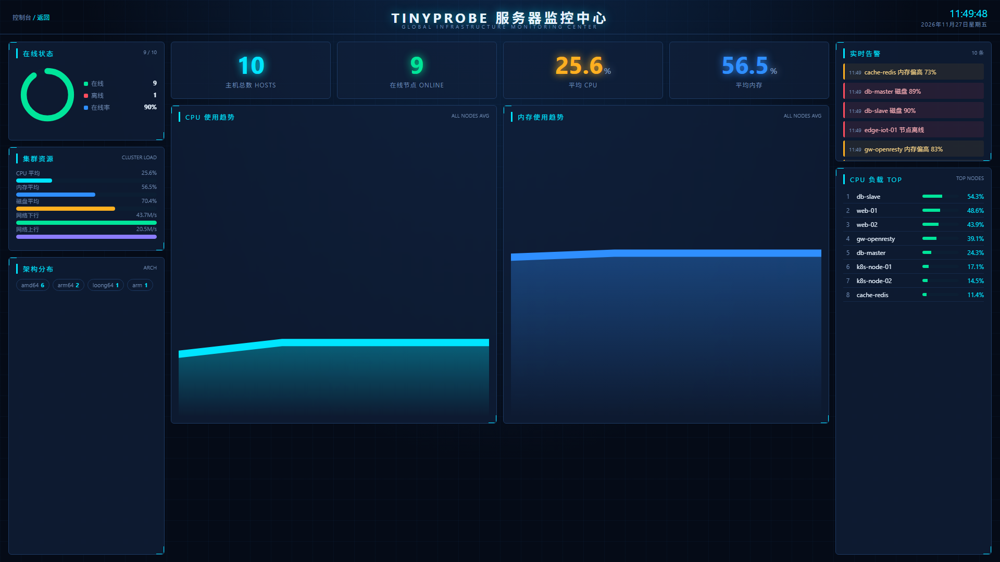

# tinyprobe — 全架构自适配 · 自注册自启动 · 控制台远程更新的极轻量服务器探针

零依赖、静态单文件、约 5 MB 磁盘 / 2–4 MB 内存。服务器上**不需要任何运行环境**（无 Node/Python/Go/glibc），上传一个二进制即可。

设计参考 GitHub 上 [henrygd/beszel](https://github.com/henrygd/beszel) 的单文件 agent 思路，但完全独立实现、纯 Go 标准库。

## 能力总览

| 能力 | 实现 |
|---|---|
| 全架构 | 12 个 Linux 架构静态二进制，安装脚本自动 `uname -m` 识别并下载对应版本 |
| 自注册自启动 | `install.sh` 注册 systemd 服务并 `enable + start`；无 systemd 用 nohup 兜底 |
| 控制台远程更新 | hub 控制台设置目标版本 + 下载模板，agent 上报时对比版本，**自动下载→校验 SHA256→替换自身→重启** |
| 极轻量 | CGO_ENABLED=0 静态编译，`-s -w` 去符号，systemd 限 `MemoryMax=32M CPUQuota=10%` |

## 目录结构

```
tinyprobe/
├── agent.go                      # agent 源码（含自更新）
├── hub.js                        # 控制台（主机监控 + 远程更新管理）
├── dist/                         # 12 个架构二进制 + SHA256SUMS
│   ├── probe-linux-amd64
│   ├── probe-linux-arm64
│   ├── ...  (386/arm/mips*/ppc64le/s390x/riscv64/loong64)
│   └── SHA256SUMS
├── install.sh                    # 一键安装/自注册/自启动
├── uninstall.sh                  # 卸载
├── .github/workflows/build-release.yml  # 推 tag 自动编译发 Release
└── hub-state.json                # 控制台状态（运行时生成）
```

## 中控大屏

hub 内置一个全屏监控大屏（深色科技风、1920×1080 自适应）：

```
http://控制台IP:47821/screen
```

包含：主机总数 / 在线数 / 平均 CPU / 平均内存 四个 KPI、在线率环形图、集群资源条、架构分布、CPU/内存实时趋势曲线、实时告警面板、CPU 负载 TOP 榜。按 `F11` 全屏即可投屏。点大屏左上角「返回 /」回到管理控制台。

### 实机截图

以下截图由本机 Chrome headless 对运行中的 hub 真实渲染生成（`--window-size=1920,1080`），数据来自 sim 探针持续上报的 10 台主机（其中 1 台模拟离线以展示告警）。

中控大屏 `/screen`：



管理控制台 `/`：


> 截图中的主机名（web-01、db-master、k8s-node-01 等）为演示数据，用于展示大屏在真实浏览器中的渲染效果；接入你自己的探针后即显示真实主机。

## 一、上传到 GitHub

```bash
cd tinyprobe
git init
git add agent.go hub.js install.sh uninstall.sh dist/ .github/
git commit -m "tinyprobe: full-arch self-updating probe"
git remote add origin https://github.com/OWNER/REPO.git
git push -u origin main

# 发布版本（触发 Actions 自动编译全部架构并创建 Release）
git tag v1.1.0
git push origin v1.1.0
```

推送 `v*` 标签后，`.github/workflows/build-release.yml` 会自动编译 12 个架构、生成 SHA256SUMS、发布到 GitHub Release。Release 里的下载地址形如：

```
https://github.com/OWNER/REPO/releases/download/v1.1.0/probe-linux-amd64
https://github.com/OWNER/REPO/releases/download/v1.1.0/SHA256SUMS
```

## 二、启动控制台

```bash
node hub.js --port 47821 --admin-token mysecret
```

打开 `http://控制台IP:47821`：
- **主机标签页**：实时看 CPU / 内存 / 磁盘 / 网络 / 架构 / 版本。
- **远程更新标签页**：配置目标版本、下载地址模板、SHA256SUMS 模板，开启 armed，可强制更新单台。

## 三、接入主机（控制台后台自动生成安装命令）

**不用手拼 IP/端口/token。** 打开控制台 `http://控制台IP:47821` → 切到「接入主机」标签 → 填节点名 → 命令自动生成并一键复制。命令里的 `HUB` 就是你**当前访问控制台的真实地址**，`TOKEN`/`VERSION`/`REPO` 也按后台配置自动填好。中控大屏左上角也有「接入命令」快捷入口。

生成出来的命令长这样（地址按你实际访问自动变）：

```bash
curl -fsSL https://github.com/songyouxi/tinyprobe/raw/main/install.sh \
| HUB=http://控制台IP:47821 NAME=web-01 TOKEN=mysecret VERSION=v1.1.0 \
REPO=https://github.com/songyouxi/tinyprobe/releases/download bash
```

复制到目标服务器执行即可自动与控制端互通。原理：hub 的 `/api/bootstrap` 接口读取请求的 `Host` 头和命令行 `--token`，实时拼出这条命令（见 `hub.js`），所以你从哪个地址进控制台，命令就指向哪个地址。

## 四、服务器一行安装（自适配 + 自启动）

手动安装也可以直接用下面这条（等价于后台生成的）：

```bash
HUB=http://控制台IP:47821 NAME=web-01 \
REPO=https://github.com/songyouxi/tinyprobe/releases/download/v1.1.0 \
VERSION=v1.1.0 \
bash <(curl -fsSL https://raw.githubusercontent.com/songyouxi/tinyprobe/main/install.sh)
```

脚本会：识别架构 → 下载 `probe-linux-<arch>` → 校验 SHA256 → 装到 `/usr/local/bin/tinyprobe-probe` → 注册 systemd 服务 `tinyprobe` → `enable --now`。控制台主机列表随即出现该节点。

卸载：`bash uninstall.sh tinyprobe`

## 五、远程更新完整流程

1. 推新 tag（如 `v1.1.0`），Actions 自动发新 Release（含新二进制 + SHA256SUMS）。
2. 控制台「远程更新」填：
   - 目标版本：`v1.1.0`
   - 地址模板：`https://github.com/OWNER/REPO/releases/download/{ver}/probe-linux-{arch}`
   - SHA256SUMS 模板：`https://github.com/OWNER/REPO/releases/download/{ver}/SHA256SUMS`
   - 点「刷新 SHA256 清单」，勾选 armed，保存。
3. 所有旧版本 agent 下次上报（默认 2 秒）即收到更新指令：
   - 按自己架构拼出 URL 与 SHA256
   - 下载到 `.update.tmp` → 校验 SHA256 → `rename` 覆盖自身
   - systemd 下 `systemctl restart tinyprobe`，无 systemd 则 `exec` 自重启
   - 重启后上报新版本号，控制台不再下发
4. 单台立即更新：主机表格点「强制更新」（清除抑制，下次上报立刻下发）。

防抖：同一主机同一目标版本 60 秒内只下发一次，避免重复更新；版本一致则不下发。

## 六、安全

- agent 上报可用 `-token SECRET`，hub 启动时 `--token SECRET` 校验。
- 管理 API 用 `--admin-token`，Web 控制台输入后存在浏览器 sessionStorage。
- 更新强制 SHA256 校验，不匹配拒绝替换。

## 七、agent 参数

| 参数 | 默认 | 说明 |
|---|---|---|
| `-hub` | `http://127.0.0.1:47821` | 控制台地址 |
| `-name` | 主机名 | 节点显示名 |
| `-interval` | `2` | 上报间隔秒 |
| `-disk` | `/` | 监控挂载点 |
| `-token` | 空 | 上报令牌 |
| `-service` | `tinyprobe` | 自更新后重启的 systemd 单元名 |

## 八、自检状态

- 当前版本：**v1.1.0**（版本演进详见 [CHANGELOG.md](CHANGELOG.md)）。
- 已编译 **12/12** 架构，全部 ELF 有效、`CGO_ENABLED=0` 静态链接。
- 版本号注入已验证（二进制含 `v1.1.0`）。
- hub 更新指令端到端测试通过：版本对比 → 按架构拼 URL → SHA256 下发 → 60 秒防抖 → 管理令牌鉴权 403 → 当前版本不下发。
- 落盘节流测试通过：200 次上报 / 5 秒窗口仅写盘 2 次，状态文件约 2.4 KB。

## 九、自行编译其它架构

```powershell
$env:GOROOT='D:\deepseekHarness\tinyprobe\.gotool\go'
$env:CGO_ENABLED='0'; $env:GO111MODULE='off'; $env:GOOS='linux'; $env:GOARCH='arm'
& 'D:\deepseekHarness\tinyprobe\.gotool\go\bin\go.exe' build -trimpath -ldflags="-s -w -X main.Version=v1.1.0" -o dist\probe-linux-arm agent.go
```
